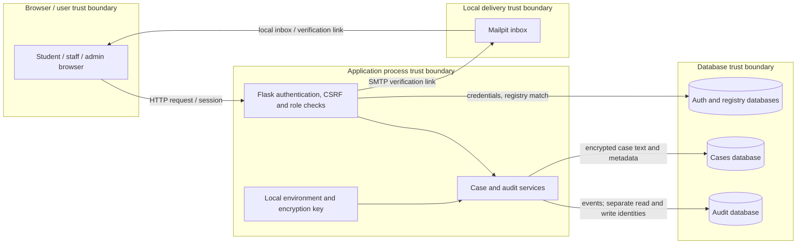

# 03 — Threat model

Assets: account credentials and sessions; registry identity; case text and private
notes; case metadata; keys; and audit records. Actors: student, staff, admin, malicious
visitor, database operator and local machine operator. The model assumes a single local
Flask process, standalone MongoDB and Mailpit; privileged host or database compromise
is not fully mitigated. Local HTTP is not transport encryption. The threats are a
structured analysis, not proof that all attacks have been eliminated.

Boundaries: B1→B2 is untrusted user input and session presentation; B2→B3 uses
configured database identities, but those credentials coexist within one process;
B2→B4 and B4→B1 represent local mail delivery, which proves no institutional
mailbox ownership. B2 key files are readable by the app operator. MongoDB and Mailpit
ports are localhost-bound in the current Compose file. TLS termination is planned.

| Threat | STRIDE | Scenario and impact | Mitigation / status | Linked test |
| --- | --- | --- | --- | --- |
| T-01 | Spoofing | Guess credentials or replay a stolen session to impersonate a student. | M-01 Argon2id, lockout and IP limit; revocable sessions planned. | TC-01 |
| T-02 | Spoofing | Register using someone else's registry ID/email. | M-02 Atomic registry claim and mailbox-owner-chosen final password; local Mailpit is not real proof. | TC-02 |
| T-03 | Information disclosure | Change a case reference to read another student's case. | M-03 Owner query and 404. | TC-03 |
| T-04 | Elevation of privilege | Staff open another officer's or an unclaimed case, or access staff notes as a student. | M-04 Role/assignment checks, metadata-only queue and student projection. | TC-04 |
| T-05 | Tampering | Forge POSTs or overwrite a newer staff update. | M-05 CSRF, transition validation and conditional version update. | TC-05 |
| T-06 | Information disclosure | Read case text from database documents or move ciphertext to another case. | M-06 Fernet and case/field binding; metadata and local keys remain exposed to authorised operators. | TC-06 |
| T-07 | Elevation of privilege / tampering | Supply role or MongoDB operator fields to bypass account/case checks. | M-07 Server-side role assignment and scalar validation. | TC-07 |
| T-08 | Repudiation | Deny a case update, or lose its audit record during an outage. | M-08 Content-free audit events; durable delivery is planned. | TC-08 |
| T-09 | Denial of service | Exhaust sign-in resources or exploit service/database failure. | M-09 Input limits, local IP rate limits, temporary lockout and safe errors; shared limits planned. | TC-09 |

STRIDE covers spoofing, tampering, repudiation, information disclosure, denial of
service and elevation of privilege ([Microsoft, n.d.](https://learn.microsoft.com/en-us/azure/security/develop/threat-modeling-tool-threats)).
OWASP Top 10:2025 provides a complementary risk taxonomy, including broken access
control, cryptographic failures, injection and logging failures ([OWASP Foundation, 2025](https://top10.owasp.org/)).
