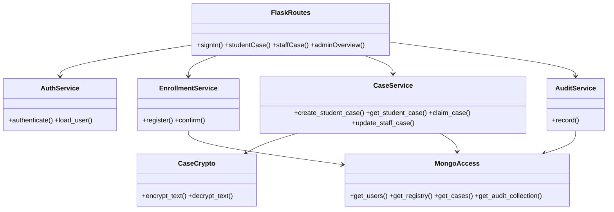
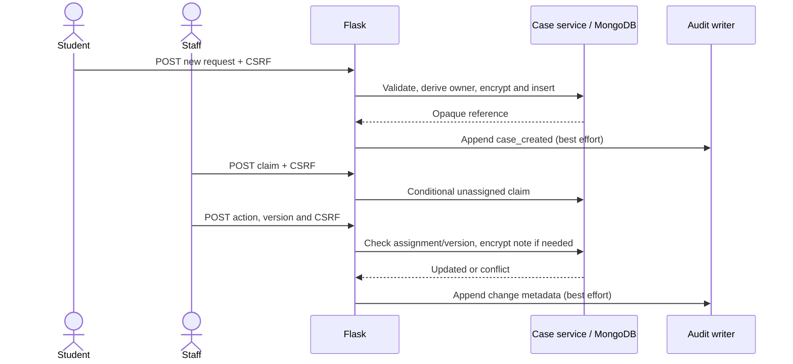

# 04 — Design

## Components and data boundaries

The following UML is a conceptual view of current modules, not a claim that every box
is a Python class. The MongoDB collections are separate logical stores; one Flask
process can still hold multiple identities and the encryption key.



## Registration sequence

```mermaid
sequenceDiagram
  actor Student
  participant Flask
  participant Registry
  participant AuthDB
  participant Mailpit
  Student->>Flask: POST validated signup + CSRF
  Flask->>Registry: Atomically claim matching ID and email
  Registry-->>Flask: matched / no match
  opt matched
    Flask->>AuthDB: Create inactive student and token hash
    Flask->>Mailpit: Send local verification link
  end
  Flask-->>Student: Neutral response
  Student->>Flask: GET confirmation page; POST token and new password
  Flask->>AuthDB: Check expiry and atomically activate
  Flask-->>Student: Generic outcome
```

Mailpit is a development mailbox and does not verify a real institutional address.
The initial signup password is not the final active credential: the mailbox-link holder
sets that password during confirmation. A crash between registry claim and account
creation can strand a claim because the local server is standalone.

## Student case and staff update sequence



## RBAC matrix

| Action | Student | Staff | Admin |
| --- | --- | --- | --- |
| View/create own case; reply when awaiting student | Yes, owner scoped | No student route | No case-content route |
| See unassigned queue metadata | No | Yes; claim required for detail | Aggregate metadata only |
| View/update assigned case and private notes | No | Yes, assigned cases only | No |
| Archive/reassign a case | No | Yes, assigned case, version and CSRF | No |
| View case counts | No | No | Yes, aggregated |
| View user list and audit timeline | No | No | Yes, limited fields and separate audit reader |
| Deactivate/reactivate eligible users; demote eligible staff to student | No | No | Yes, subject to server checks; never modify an admin through this UI |
| Create privileged account or promote in web UI | No | No | No; operator uses CLI |

Admin reactivation requires the corresponding identity-verification flags; user listing
is limited to 100 entries. The controls apply to the running application; database or
host operators are more privileged.

## Decisions and rejected alternatives

1. **Argon2id over fast SHA-256 for passwords:** it increases the cost of offline
   guessing. It uses resources on each sign-in, so limits remain important. Token
   hashes use SHA-256 because tokens are randomly generated rather than human chosen.
2. **Owner/assignment predicates over hidden controls:** they enforce the boundary at
   the data access layer. Opaque references add resistance to guessing but do not
   replace authorisation.
3. **Fernet per text item over plaintext:** protects text from a database-only reader
   without the key; it still exposes metadata and does not protect a compromised app.
4. **Conditional version writes over last-write-wins:** avoids silent overwrites; users
   must refresh and retry on conflicts.
5. **Registry plus local Mailpit over fabricated identity proof:** supports a free demo;
   it is not an institutional identity or delivery system.
6. **Separate audit writer and reader over one shared audit identity:** reduces routine
   write privileges of the viewer; it does not provide durable or tamper-proof logging.

See [07-evaluation](07-evaluation.md) for residual risks and limitations.
